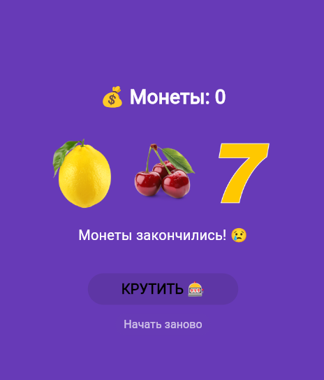

# Лабораторная работа №9. Flutter: StatefulWidget и управление состоянием

#### Автор:

- Афанасьев Глеб Викторович
- ИСП-242
- Дата сдачи: 14.11.2026

## Что изучили

В ходе выполнения лабораторной работы были освоены следующие темы:
1. **Разница между `StatelessWidget` и `StatefulWidget`** — научились определять, когда виджету необходимо хранить изменяемое состояние, а когда достаточно статической конфигурации.
2. **Управление состоянием через `setState()`** — изучили, как правильно уведомлять Flutter об изменениях данных для перерисовки интерфейса.
3. **Подключение локальных ресурсов (assets)** — разобрались, как регистрировать изображения в `pubspec.yaml` и выводить их с помощью `Image.asset`.
4. **Асинхронность в UI** — научились использовать `Future`, `async/await` и `Future.wait` для создания реалистичной анимации барабанов, а также проверять `mounted` для предотвращения ошибок после удаления виджета.
5. **Создание анимаций** — применили `AnimatedOpacity` для плавного приглушения изображений во время вращения и `AnimatedSwitcher` для красивой смены текстовых сообщений.

## Скриншот финального приложения

### Инструкция по запуску:

1. git clone https://github.com/Fraay/Flutter_Lab9
2. cd slot_machine_afanasev
3. flutter pub get
4. flutter run -d chrome